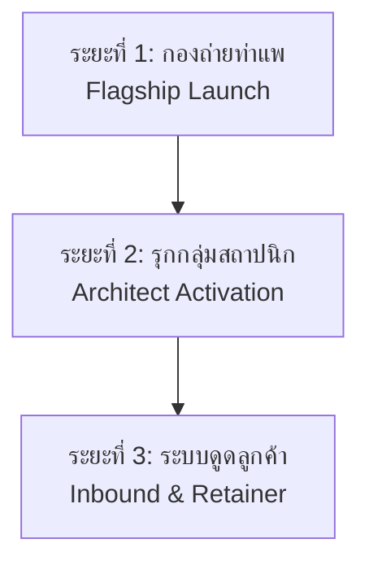

# 🏛️ Feltz Studio — Master Marketing Strategy & Execution Plan (2026-2027)
**จัดทำโดย:** ฝ่ายกลยุทธ์การตลาดและการสร้างแบรนด์ Feltz Studio  
**สำหรับ:** คุณมงคล วงศ์สกุลยานนท์ (เก่ง - ChZ) | ผู้ก่อตั้ง Feltz Studio  
**เอกสารเวอร์ชัน:** 1.0 (Official Strategic Blueprint)

---

## 🧭 1. Executive Summary & Brand Positioning

### 1.1 ปัญหาเดิม (The Old Reality)
* พึ่งพาเฉพาะงานตกหล่น (Overflow) จากเพื่อนในวงการ ทำให้รายได้แกว่งรุนแรง (10,000 - 100,000 บาท/เดือน)
* ขายเวลาเป็นรายชั่วโมง (4,000 - 8,000 บาท) ถูกมองเป็นต้นทุน ไม่ใช่การลงทุน
* แบกรับความกดดันด้านความคิดสร้างสรรค์คนเดียว (Creative Fatigue จากงานจักรยานประจำ)
* ส่งงานเสร็จแล้วแยกย้าย ไม่เคยสานสัมพันธ์หรือดึงคอนเนกชันมาต่อยอดเป็นธุรกิจ

### 1.2 ตำแหน่งแบรนด์ใหม่ (The New Strategic Positioning)
> **"Feltz Studio — Hospitality & Space Visual Specialist"**  
> *ช่างภาพผู้เชี่ยวชาญด้านภาพลักษณ์โรงแรม ที่พัก และสเปซสถาปัตยกรรม ที่ผสานความคมชัดเชิงพาณิชย์เข้ากับอารมณ์ความรู้สึกแท้จริงของมนุษย์ (Commercial Clarity + Authentic Emotion)*

---

## 🎯 2. กลุ่มเป้าหมายหลักและพฤติกรรมลูกค้า (Target Personas)

### Tier 1: เจ้าของบูทีคโฮเทล & พูลวิลล่า (The Boutique Owner)
* **ความต้องการแท้จริง:** รูปที่ "ขายห้องพักได้จริง" สะอาด โปร่ง สบายตา และมีมู้ดชวนพักผ่อนเพื่อดึงดูดแขกต่างชาติบน OTA
* **ตัวอย่างความสำเร็จเดิม:** เจ้าของโรงแรม The Moment ท่าแพ (ลูกค้าประจำที่ชื่นชอบงานภาพที่มีอารมณ์)
* **การตั้งราคา:** 15,000 - 35,000 บาท ต่อโครงการ (คิดตามมูลค่า ไม่คิดรายชั่วโมง)

### Tier 2: สถาปนิก & อินทีเรียดีไซเนอร์ (The Design Partner)
* **ความต้องการแท้จริง:** ภาพเก็บพอร์ตโฟลิโอส่งประกวดแบบ ลงนิตยสารดีไซน์ (art4d, Dsign Something) ที่เคารพเส้นสายสถาปัตยกรรม รอยต่อวัสดุ และแสงเงา
* **บทบาทต่อ Feltz:** เป็น "เครื่องจักรแนะนำลูกค้าไม่รู้จบ" สถาปนิก 1 คนมีงานสร้างเสร็จปีละหลายหลัง และเป็นคนแนะนำให้เจ้าของตึกจ้างช่างภาพโดยตรง

### Tier 3: กีฬาจักรยาน & คอมมูนิตี้ (The Community Engine)
* **พันธมิตรหลัก:** พี่ต้อม / ฟูจิยาม่า 55 ไซคลิ่ง
* **แนวทางใหม่:** ถ่ายด้วยความสุขในฐานะคนรักกีฬา เลิกกดดันตัวเองเรื่องมุกใหม่ เน้นจังหวะจริงและเพื่อนฝูง

---

## 📐 3. ไวยากรณ์สายตา 5 มุมมองสถาปัตยกรรม (Interior Visual Grammar)
*คู่มือสำหรับเก่งใช้ศึกษาและฝึกสายตาก่อนลงสนามจริง*

```
[ 1. One-Point Perspective ]   -> ยืนกึ่งกลางระนาบ คุมเส้นเสา/ขอบผนังให้ตั้งฉาก 90 องศาเป๊ะ
[ 2. Natural Light Window Pull] -> เก็บแสงแดดที่ลอดผ่านหน้าต่าง ไม่ให้หน้าต่างขาวโพลนจนหลุดดีเทล
[ 3. Material & Craft Vignette] -> เจาะรอยต่อไม้ ปูน กระจก หรือผิวสัมผัสงานคราฟต์ที่สถาปนิกตั้งใจออกแบบ
[ 4. Space with Human Life ]   -> ภาพห้องที่มีชีวิต มีกาแฟตั้ง มีรอยยับบนผ้าปู หรือมีคนนั่งในมุมสบาย
[ 5. Cinematic Twilight ]       -> จังหวะฟ้าสีน้ำเงินตัดกับไฟวอร์มไวท์ของอาคาร (15 นาทีทองยามเย็น)
```

---

## 🗺️ 4. แผนปฏิบัติการ 3 ระยะ (Strategic Execution Roadmap)



### ระยะที่ 1: กองถ่ายโรงแรมใหม่ย่านท่าแพ (ต้นเดือนหน้า) — The Catalyst
1. **งานหลัก:** ถ่ายภาพการตลาดโรงแรมให้เจ้าของ (สะอาด โปร่ง สบายตา ครบทุกรูมไทป์)
2. **งานเก็บพอร์ตพิเศษ:** กดภาพชุด "Architectural & Interior Details" เพิ่ม 15 ช็อต (เจาะเส้นสาย แสงเงา รอยต่อวัสดุ)
3. **การเก็บทรัพย์สินทางธุรกิจ:**
   * ถามชื่อและคอนแทกต์ของสถาปนิก/อินทีเรียร์ผู้ออกแบบโรงแรมนี้
   * ขอคำนิยมสั้นๆ (Testimonial) 1 ประโยคจากเจ้าของโรงแรม เพื่อนำมาขึ้นเป็นรีวิวบนหน้าเว็บ Feltz

### ระยะที่ 2: กระตุ้นเครือข่ายสถาปนิกในเชียงใหม่ (เดือนที่ 2)
1. นำภาพโรงแรม The Moment + โรงแรมใหม่ท่าแพ มาจัดเป็น **Architectural Showcase PDF 5 หน้า**
2. ทักทายสถาปนิกที่เก่งรู้จักอยู่แล้ว 5-10 คน ด้วยข้อความแบบกัลยาณมิตร:
   > *"พี่ครับ ช่วงนี้ผมขยับมาโฟกัสงานถ่าย Interior & Space เต็มตัว กำลังรวบรวมงานตึกสวยๆ ในเชียงใหม่ ถ้าพี่มีโปรเจกต์ไหนเพิ่งสร้างเสร็จอยากเก็บภาพพอร์ตส่งรางวัล ทักมาคุยกันได้เลยครับ"*
3. ให้ราคาพิเศษแบบ "Portfolio Package" สำหรับงานแรก เพื่อเปิดประตูและสร้างความคุ้นเคย

### ระยะที่ 3: เครื่องจักรดูดลูกค้าอัตโนมัติ (เดือนที่ 3 เป็นต้นไป)
1. โพสต์ผลงานสเปซลงโซเชียลสัปดาห์ละ 2 ครั้ง โดยแท็กและให้เครดิตสถาปนิกและโรงแรมทุกครั้ง (เพื่อให้เกิดการแชร์ข้ามกลุ่ม)
2. สร้างแพ็กเกจ Annual Visual Retainer สำหรับโรงแรมที่มีการเปลี่ยนฤดูกาล (เช่น ถ่ายรีเฟรชภาพ High Season และ Green Season)

---

## 💵 5. เป้าหมายรายได้และโครงสร้างการเงิน (Financial Targets)

| เป้าหมาย | จำนวนงานที่ต้องปิด | แหล่งที่มาของรายได้ | รายได้รวมต่อเดือน |
| :--- | :---: | :--- | :---: |
| **ระดับพื้นฐาน (Baseline)** | 2 งานโรงแรม | โรงแรม/วิลล่า (20,000 x 2) + อีเวนต์/จักรยาน (10,000) | **50,000 บาท** |
| **ระดับเป้าหมาย (Target)** | 3 โรงแรม + 1 สถาปัตย์ | โรงแรม (25,000 x 3) + งานสเปซสถาปนิก (15,000) | **90,000 บาท** |
| **ระดับขยายสเกล (Scale)** | 4 โรงแรม + ต่อยอดทีม | โรงแรมพรีเมียม (30,000 x 4) + กระจายงานอีเวนต์ให้เพื่อน | **120,000+ บาท** |
